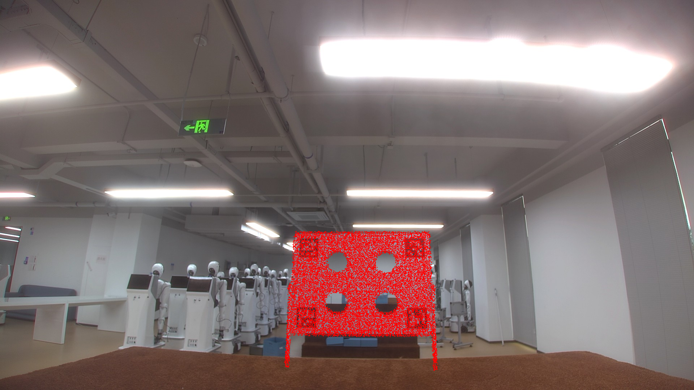
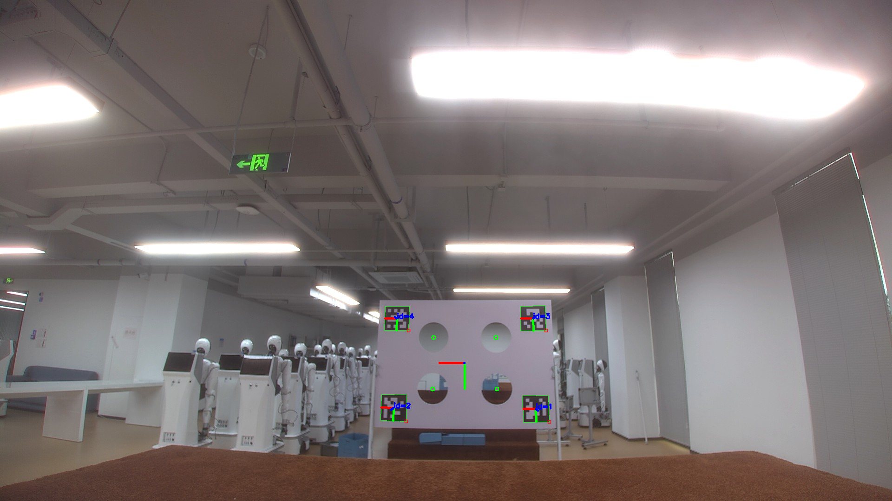
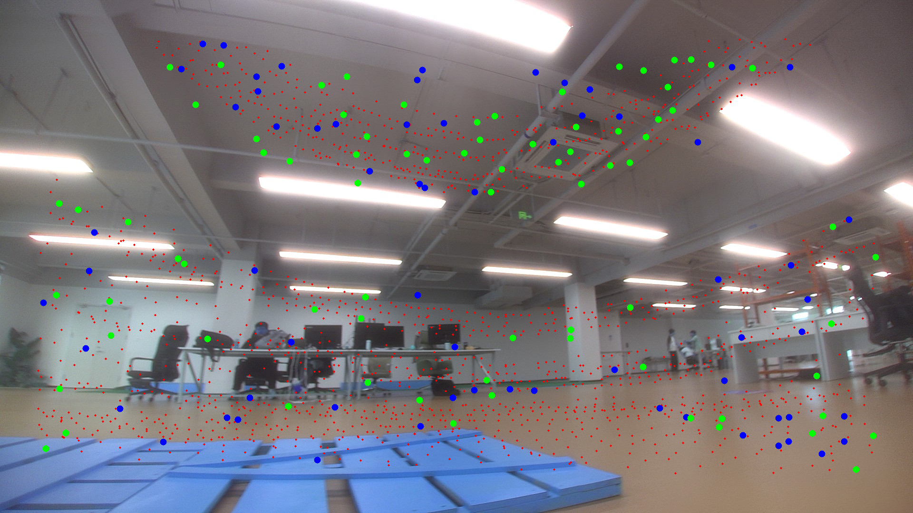

# REDO6 相机—Livox MID-360 标定与验证

Camera–LiDAR extrinsic calibration for a cylindrical RGB camera and Livox MID-360.

本仓库公开最终标定参数、通用复现说明和现场验证图片，并提供助手编写的投影、彩色点云与参数检查脚本。相机是 **RGB 相机，不是深度相机**。

公开版已移除内部账号、主机信息和个人绝对路径，不包含公司工程源码、完整第三方标定器源码、原始录包和模型权重。另提供来源、版本和许可明确的 FAST-Calib 与 FAST-LIVO2 修改补丁，已补齐本次选定六个文件的改动。完整实机工作空间、原始数据与设备配置未公开，因此本仓库是**标定结果、验证资料与源码补丁交付**，不能宣称从零完整复现所有历史系统。

## 结果与证据

| 项目 | 结果或事实边界 |
|---|---|
| 标定轮次 | REDO6，最终参数日期 2026-08-17 |
| 相机模型 | Pinhole，1920 × 1080，五参数 `plumb_bob` |
| 最终参数 | [front_camera_mid360_extrinsics_final.yaml](config/front_camera_mid360_extrinsics_final.yaml)，保留原始字节 |
| YAML 记录的 RMSE | 0.0041 m；求解日志与误差定义未随包提供，不称作像素重投影误差 |
| 标定板图像检测 | 原始 YAML 记录 4 个相机圆心、4 个 LiDAR 边缘簇 |
| 标定板投影图 | 真实现场图，见下方；单张图不代表全视场定量精度 |
| 独立 FAST-LIVO2 历史验证 | 2026-09-01 报告记录 901 帧、4,103,770 个对应点 |
| 本次发布准备 | 校验参数、源文件摘要及 Python 语法；没有运行 ROS、求解器或重新回放录包 |

标定板投影：



相机侧标定目标检测：



独立录包中的历史叠加图：



## 文件说明

| 路径 | 用途 |
|---|---|
| `config/front_camera_mid360_extrinsics_final.yaml` | 用户得到的最终原始参数 |
| `results/calib_result.txt` | 原始参数导出文件；该文件自身没有 RMSE 数值 |
| `config/fast_calib/qr_params.template.yaml` | 标定参数模板；移除输入输出绝对路径并修正旧相机注释 |
| `config/fast_livo2/machine_dog_redo6_camera.yaml` | 历史验证的相机参数；只有四项畸变，不包含 k3 |
| `config/fast_livo2/rosbag_play_qos.yaml` | 历史回放 QoS 配置 |
| `scripts/check_calibration.py` | 本次编写的本地参数与逆变换检查工具 |
| `scripts/lidar_camera_projection.py` | 历史助手编写的独立投影参考脚本 |
| `scripts/colored_point_cloud.py` | 历史助手编写的彩色点云参考脚本 |
| `scripts/raw_lidar_cloud.py` | 历史助手编写的 CustomMsg→PointCloud2 参考脚本 |
| `scripts/analyze_correspondence_bag.py` | 本次重新编写的离线消息检查工具 |
| `launch/validate_livo.launch.py` | 本次编写的公开验证启动示例；需要外部完整配置与程序 |
| `docs/TEST_REPORT_20260901.md` | 历史报告公开摘录；不是本次重新运行结果 |
| `docs/RELEASE_AUDIT.md` | 参数一致性、缺口与脚本限制 |
| `docs/CALIBRATION_METHOD.md` | 从采集到验收的通用详细流程 |
| `docs/COORDINATES_AND_TF.md` | 变换方向、光学帧与 TF 使用说明 |
| `docs/PUBLISH_TO_GITHUB.md` | GitHub 发布步骤 |
| `docs/SOURCE_FILES.json` | 公开原始文件的摘要及处理说明，不含内部来源路径 |
| `docs/UPSTREAM_AND_PATCHES.md` | 确切上游版本、三个补丁及应用方法 |
| `docs/FAST_LIVO2_CORRESPONDENCE.md` | mapper 对应消息的世界坐标、筛选和时间戳边界 |
| `docs/UPSTREAM_VERSIONS.json` | 核实后的公开基线与补丁摘要 |
| `patches/fast_calib/0001-redo6-circle-fit.patch` | 相对明确上游版本的圆拟合日志与门限修改，GPL-2.0 |
| `patches/fast_calib/0002-redo6-k3-distortion.patch` | 标定器读取并使用第五项畸变 k3，GPL-2.0 |
| `patches/fast_livo2/0001-pixel-correspondence-and-image-ownership.patch` | 世界点↔像素接口、图像所有权修复与红点显示，GPL-2.0 |
| `third_party/fast_calib/LICENSE`、`third_party/fast_livo2/LICENSE` | 两套补丁对应的原始许可 |
| `scripts/collect_repro_sources.py` | 收集选定修改文件供后续审核，不直接发布输出 |

## 相机参数

最终原文件的内参为：

```text
K = [796.164262460850, 0,                998.040267016264
     0,                796.565439605239, 586.594945318602
     0,                0,                1]

D = [-0.107115015572, 0.014040533509,
      0.000011518208, 0.000091001532, -0.000901838357]
```

D 的顺序为 `[k1,k2,p1,p2,k3]`。参数对应 1920 × 1080 图像；图像缩放、裁剪或去畸变后必须使用匹配的 K/D。不能仅凭分辨率相同就认定参数仍然匹配。

历史 FAST-LIVO2 相机配置只记录前四项，其第五项 k3 没有进入该配置。这个差异已保留并说明，不静默修改历史参数。

## 外参及坐标方向

最终参数采用：

\[
\mathbf p_C = \mathbf R_{CL}\mathbf p_L + \mathbf t_{CL}.
\]

```text
R_CL = [-0.020792, -0.999597,  0.019323
         0.520325, -0.027322, -0.853531
         0.853715, -0.007692,  0.520683]

t_CL = [0.002680, -0.253080, 0.059294] metres
```

数值检查：`det(R) ≈ 0.9999994339`，`||R^T R-I||_F ≈ 1.207e-6`。它说明矩阵接近合法旋转，不等于测得了标定精度。

以 LiDAR 为父帧、相机光学帧为子帧时，使用逆变换 `R_LC=R_CL^T`、`t_LC=-R_CL^T t_CL`。近似值：

```text
t_LC = [0.0811194, -0.0037796, -0.2469368] metres
q_LC (x,y,z,w) = [-0.34851367, 0.34379725, -0.62625819, 0.60674735]
```

四元数整体变号表示同一旋转。原始 YAML 相机帧写为 `camera_frame`，而某些系统使用单独的光学帧；实际部署必须确认坐标轴，不能直接改字符串代替坐标检查。

## 1. 无 ROS 的参数检查

在有 NumPy 和 PyYAML 的 Python 环境中，从仓库根目录执行：

```bash
python3 scripts/check_calibration.py
```

若需要独立环境：

```bash
python3 -m venv .venv
source .venv/bin/activate
python3 -m pip install -r requirements.txt
python3 scripts/check_calibration.py
```

该工具读取真实最终 YAML，检查有限值、图像尺寸、内参及旋转数值，并计算逆变换。生成逆变换时只对已经接近正交的矩阵做小数舍入修正，源文件不变。

运行 ROS 示例时应使用能导入系统 ROS 包的 Python 环境；不要把独立 venv 默认当作 ROS 运行环境。

## 2. 独立点云投影参考

以下三个脚本是历史参考实现，本次仅做源码核对与语法检查。它们不是严格同步的实时融合方案。输入默认使用 Livox `CustomMsg` 与压缩 RGB 图像，并把当前最新图像用于投影/取色。

分别在正确 ROS 环境的独立终端中运行：

```bash
source /opt/ros/humble/setup.bash
source /你自己的驱动工作空间/install/setup.bash
python3 scripts/lidar_camera_projection.py
```

```bash
python3 scripts/colored_point_cloud.py
```

```bash
python3 scripts/raw_lidar_cloud.py
```

依赖：`rclpy`、`sensor_msgs`、`livox_ros_driver2`、NumPy 和 OpenCV。驱动工作空间需要由使用者提供。

| 脚本 | 输入 | 输出 |
|---|---|---|
| 投影 | `/livox/lidar`、`/front_camera/image_compressed` | `/pixel_point_correspondence`、`/projection_image/compressed` |
| 彩色点云 | 压缩图像、`/pixel_point_correspondence` | `/lidar_camera/colored_points` |
| 原始点云转换 | `/livox/lidar` | `/lidar_camera/raw_points` |

投影参考脚本使用硬编码的 REDO6 K/D/R/t，不会自动读取最终 YAML。发布准备时已经比对两者一致；若以后改变 YAML，需要同步核对脚本。

参考脚本将 xyz 作为原始 LiDAR 坐标，depth 为相机 Z。它们强制使用帧名 `livox_frame`，投影图使用 `camera_frame`。仅在真实输入坐标符合这些约定时使用；不能直接把已注册到 map 的点云送进该脚本。

应先在静止场景验证。移动目标、机器人运动或图像滞后时，最新图像策略可能产生错位。也不要同时运行另一个发布 `/pixel_point_correspondence` 的算法，避免不同坐标定义混流。

原始点云转换脚本可以通过 ROS remap 输出到其他话题，但本仓库没有证据表明它就是历史求解时使用的桥接程序。

## 3. 外参重新求解：输入仍需自行提供

本仓库不包含完整 FAST-Calib 源码、原始标定图像或 LiDAR 标定包，但提供针对三个选定文件的两个已核对补丁。上游为 [ichangjian/FAST-Calib-ROS2](https://github.com/ichangjian/FAST-Calib-ROS2)，基线 commit 为 `707df94bf7a4acdcb806affed7a9e41ee179518c`。获取与应用方法见 [上游与补丁](docs/UPSTREAM_AND_PATCHES.md)。参数模板保留数值，但三个路径是显式占位符，不能不修改就启动。

使用自己的独立标定器和数据时，按 `docs/CALIBRATION_METHOD.md` 操作，核对标定板尺寸和特征编号，再配置输入图像、点云及新的输出目录。不要覆盖历史结果。

两个补丁增加圆拟合诊断日志，把圆候选接受门限由 `0.02` 改为 `0.03`，并补齐第五项畸变参数 `k3` 的读取与使用。此前缺少的两个头文件现已核对。

模板中的目标圆半径是求解器的配置值，不等于实际拟合半径或物理测量结果。标定 ROI 只用于提取标定板，不是实时视场限制。

## 4. FAST-LIVO2 验证的复现边界

上游参考为 [hku-mars/FAST-LIVO2](https://github.com/hku-mars/FAST-LIVO2)，收集到的基线 commit 为 `837b7bbc1431cb04cf936528e52c83c835efba8e`。该 SHA 已在公开仓库核实。历史报告记录 `/pixel_point_correspondence` 的实现需要本地修改过的 mapper。本仓库现在提供针对三个选定文件的 mapper 修改补丁；完整 LIVO 配置、录包与依赖仍需自行提供，原版算法加这几个 YAML 不能保证生成同样输出。获取基线并应用补丁见 [上游与补丁](docs/UPSTREAM_AND_PATCHES.md)。

新增消息的 xyz 在 `camera_init` 世界坐标，depth 是相机 Z，时间戳使用 `vio_time`。它与独立 Python 投影脚本的 `livox_frame` 对应消息不同，不能混用发布源，不能直接接入强制 LiDAR 帧名的彩色点云脚本。详细说明见 [对应接口](docs/FAST_LIVO2_CORRESPONDENCE.md)。

若你已有兼容实现和自己的完整配置，可以使用新编写的启动示例：

```bash
source /opt/ros/humble/setup.bash
source /你自己的融合工作空间/install/setup.bash
ros2 launch "$PWD/launch/validate_livo.launch.py" \
  livo_params_file:=/你自己的配置/complete_livo.yaml
```

完整配置必须把图像输入设置为示例发布的 raw 图像话题，并应用最终 YAML 的 `Rcl/Pcl`。LiDAR→IMU 参数应使用你自己的标定值；本仓库没有发布任何继承自设备工程的 LiDAR→IMU 参数。

这份 launch 是本次公开版新写的示例，未在 ROS 环境运行验证，不能当作历史成功运行的原始 launch。

回放自己的联合录包时，可以参考历史 QoS：

```bash
ros2 bag play /你自己的录包目录 \
  --qos-profile-overrides-path config/fast_livo2/rosbag_play_qos.yaml
```

实际消息、QoS、ROS domain、RMW 与时钟应由使用者核对；历史配置不保证适配所有新录包。

## 5. 对应消息离线检查

在装有 ROS bag Python API 的环境中：

```bash
python3 scripts/analyze_correspondence_bag.py /你自己的结果包目录 \
  --width 1920 --height 1080
```

默认使用 sqlite3；MCAP 需要对应存储插件及 `--storage-id mcap`。该新工具按字段偏移、行步长和大小端读取六个 FLOAT32 字段，检查有限值、像素范围和正深度。

消息合法性统计不是空间准确性评估。公开包没有结果 bag，本次不能重新计算历史 901 帧的统计。

## 6. 静态 TF

检查真实帧定义与已有发布者后，可让工具**仅打印**参考命令：

```bash
python3 scripts/check_calibration.py \
  --print-tf --parent livox_frame --child front_camera_optical_frame
```

它不会执行命令。这里的子帧名是需要使用者核实的光学帧示例。完整方向解释和检查方法见 [坐标与 TF](docs/COORDINATES_AND_TF.md)。

## 发布与许可

公开范围见 [PUBLIC_SCOPE.md](docs/PUBLIC_SCOPE.md)，GitHub 操作见 [发布步骤](docs/PUBLISH_TO_GITHUB.md)。MIT 许可适用于本仓库助手编写的代码与新写说明；图片和原始标定资产的范围见 [ASSET_NOTICE.md](ASSET_NOTICE.md)。FAST-Calib 与 FAST-LIVO2 修改补丁按 GPL-2.0 提供，不受根目录 MIT 重新许可。第三方软件继续按其各自许可使用。本仓库未复制完整第三方算法工程。
